# Segmented Home Lab: Cisco Routing & Switching + Proxmox Virtualization

A small network built to practice how real environments are designed, hardened, and monitored. It combines physical Cisco gear (891F router, Catalyst 2960 switch) with a nested Proxmox host running Rocky Linux and Docker services for uptime monitoring and DNS filtering.

I built it to go beyond CCNA lab exercises: plan a segmented network, run real services on it, troubleshoot what broke, and lock down the devices.

---

## Network Diagram

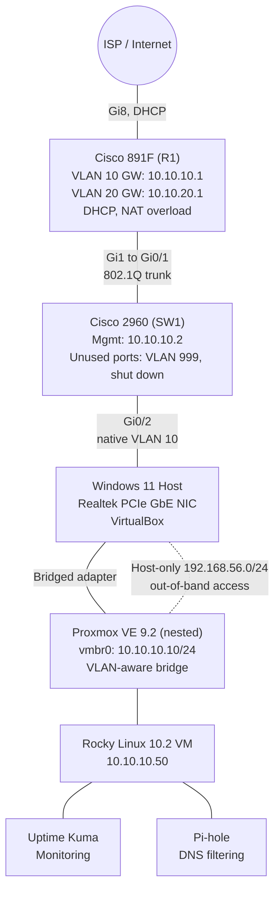

---

## Design

### VLAN plan

VLAN: 10
Name: Management
Subnet: 10.10.10.0/24
Gateway: 10.10.10.1 
Purpose: Network devices, hypervisor, admin access, lab services

VLAN: 20
Name: Server Zone
Subnet: 10.10.20.0/24
Gateway: 10.10.20.1 
Purpose: Isolated services zone

VLAN: 999
Name: Unused
Subnet: none
Gateway: none
Purpose: Parking VLAN for all unused switch ports


### Addressing

| Device           | Address                 | Notes                                                                    |
|------------------|-------------------------|--------------------------------------------------------------------------|
| R1 (Cisco 891F)  | 10.10.10.1 / 10.10.20.1 | SVI gateways, DHCP server, NAT                                           |
| SW1 (Cisco 2960) | 10.10.10.2              | Management SVI for SSH access                                            |
| Proxmox host     | 10.10.10.10             | Static, plus 192.168.56.10 on a host-only adapter for out-of-band access |
| Rocky Linux VM   | 10.10.10.50             | Static                                                                   |

Both DHCP pools exclude .1 through .10 for static infrastructure.

### Why segment?

The server zone (VLAN 20) is separated from management (VLAN 10) by an ACL on R1. Servers can reach the internet but cannot start connections into the management network, while management can still reach the servers. If a service is compromised, it can't pivot to the devices that control the network.

---

## What's Running

| Layer      | Component                             | Role                                                |
|------------|---------------------------------------|-----------------------------------------------------|
| Routing    | Cisco 891F                            | Inter-VLAN routing, DHCP, NAT/PAT, ACL enforcement  |
| Switching  | Cisco 2960                            | 802.1Q trunking, unused-port lockdown               |
| Hypervisor | Proxmox VE 9.2 (nested in VirtualBox) | VM hosting on a VLAN-aware Linux bridge             |
| Guest OS   | Rocky Linux 10.2 (minimal)            | Docker host                                         |
| Container  | Uptime Kuma                           | Availability monitoring of the gateway and internet |
| Container  | Pi-hole                               | DNS filtering (deployed, see Next Steps)            |

### Virtualization layer

Proxmox runs inside VirtualBox on my Windows PC: 4 vCPU, 8 GB RAM, 40 GB disk, UEFI, with nested VT-x/AMD-V enabled so Proxmox can run its own VMs.

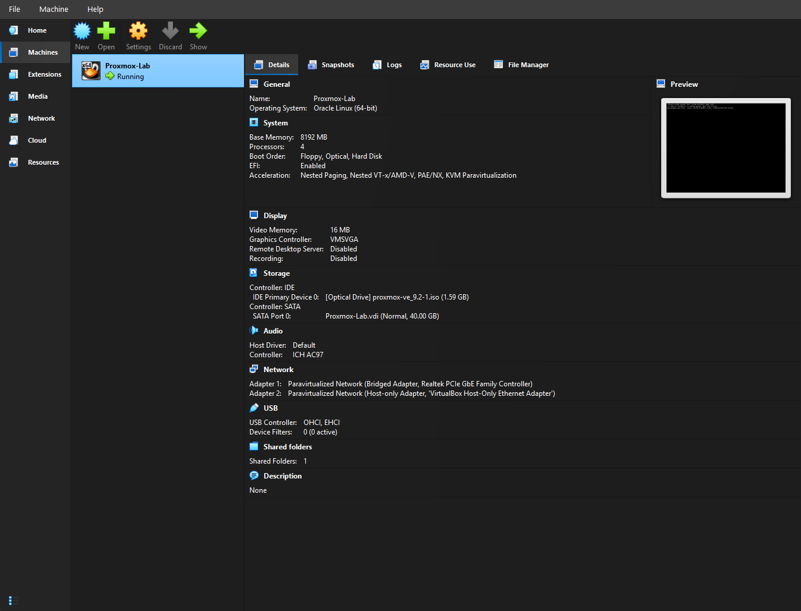

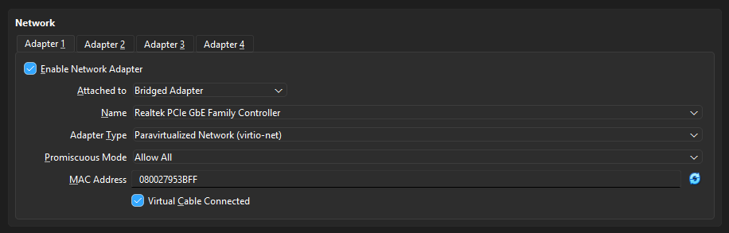

Adapter 1 is bridged to my physical NIC and uses the Paravirtualized Network (virtio-net) adapter type. Instead of emulating a real network card, the guest uses a driver designed for virtual networks, so there's less overhead and better performance. I set Promiscuous Mode to "Allow All" because my nested VM (Rocky Linux Minimal) has a different MAC address than the Proxmox VM. Normally an adapter drops frames that aren't addressed to its own MAC, so this setting lets frames meant for the nested VM reach it.

Adapter 2 is a Host-Only Adapter, which connects only to a private virtual network between my Windows PC and the Proxmox VM. This gives me out-of-band management access, so I can still reach Proxmox if the physical network or the Cisco configuration goes down. Promiscuous Mode is set to "Deny" because nothing on the host-only network needs to reach the nested VMs, so there's no reason for that adapter to accept frames addressed to other MAC addresses.

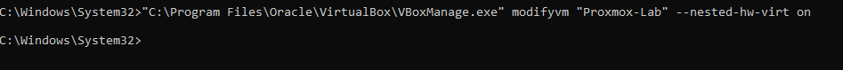

Since Proxmox was running inside VirtualBox, it didn't have access to my CPU's hardware virtualization features by default, and Proxmox needs those for KVM to run its own VMs. That command enables nested virtualization, passing VT-x/AMD-V through to the Proxmox VM so Rocky could run with hardware acceleration instead of slow software emulation.

### Proxmox networking

The Proxmox bridge `vmbr0` is VLAN-aware (VLANs 2-4094), so VMs can be placed in a VLAN by tagging their virtual NIC.

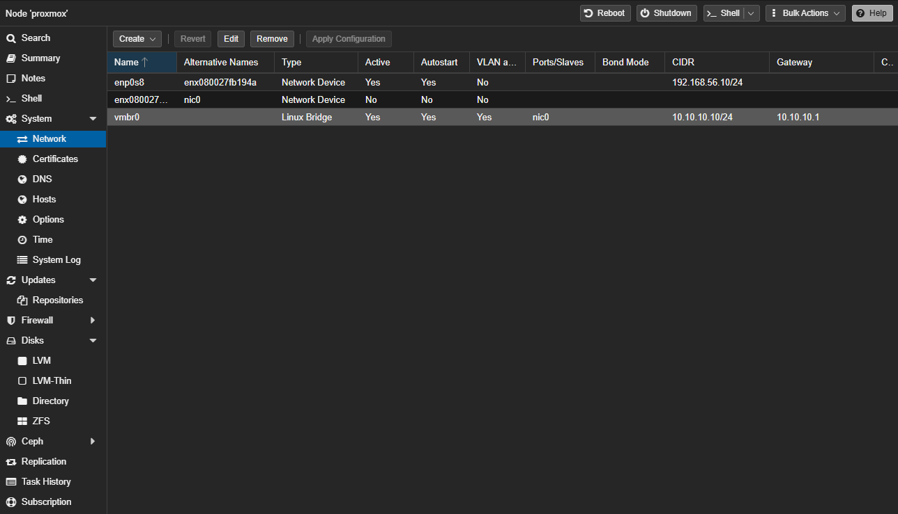

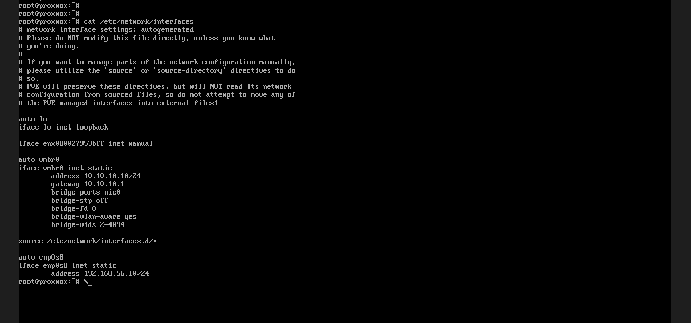

### Rocky Linux and Docker

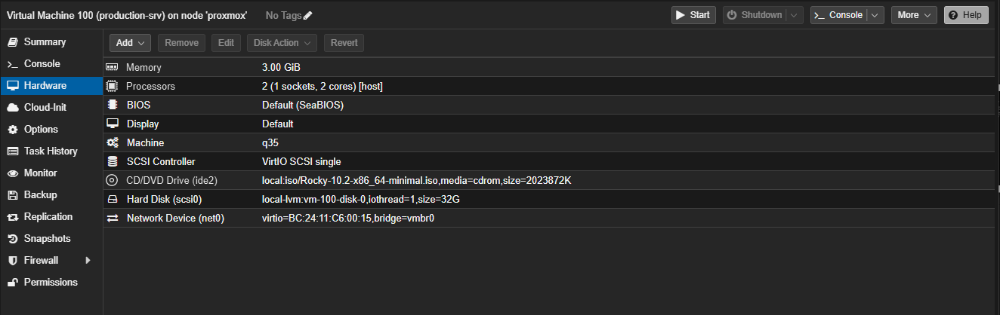

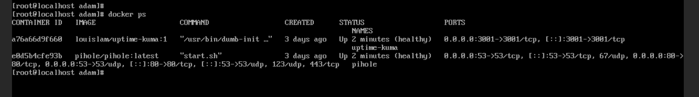

---

## Problems I Hit and How I Solved Them

### Problem 1: Proxmox lost its network connection after every VM restart

**Symptom.** Proxmox could reach the Cisco network at first, but after the VirtualBox VM was restarted, it lost all connectivity to its gateway (10.10.10.1). Pings showed 100% packet loss and the Proxmox web GUI was unreachable.

**Troubleshooting.** Proxmox's own config hadn't changed between restarts, so I looked at the layer underneath it: the VirtualBox network adapter. Switching the adapter's promiscuous mode to Deny, saving, and then switching it back to Allow All restored connectivity immediately, but only until the next restart. So the problem was in how VirtualBox applied the adapter setting at boot, not in Proxmox.

**Fix.** I set promiscuous mode from the command line with VirtualBox fully closed, which writes it directly into the VM's configuration:

```
VBoxManage modifyvm "Proxmox-Lab" --nicpromisc1 allow-all
```

After that, connectivity survived every restart.

### Problem 2: Services in VLAN 20 were unreachable from my PC

**Original design.** I had trunk VLANs 10 and 20 going from the switch into Proxmox. My PC stays in VLAN 10, the Rocky VM is tagged into VLAN 20 on the Proxmox bridge, and R1 routes between them.

**Symptom.** With Rocky tagged into VLAN 20, both containers were healthy and listening on `0.0.0.0`, but the browser on my PC could not load Uptime Kuma or Pi-hole across subnets.

**Troubleshooting.** I worked from the inside out, ruling out one layer at a time:

1. **Containers:** I confirmed that both were running and healthy, with the expected port mappings (`3001->3001` for Uptime Kuma, `80->80` for Pi-hole).
2. **Proxmox:** Disabled the Proxmox firewall to check if its blocking certain traffic... Ruled it out. No change.
3. **Windows host:** With the services and hypervisor checked, the remaining suspect was the path from the switch, through the Windows NIC, into the nested VM. I set two registry values on the Realtek driver that are meant to make it keep VLAN tags on received frames: `PreserveVlanInfoInRxPacket = 1` and `MonitorModeEnabled = 1`.

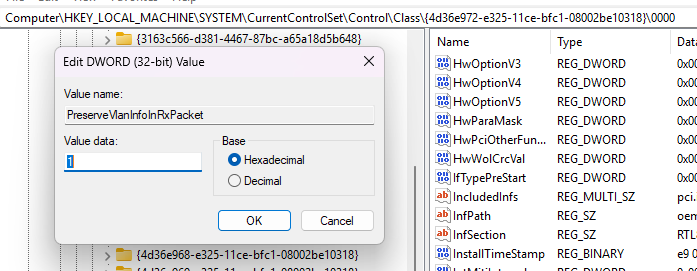

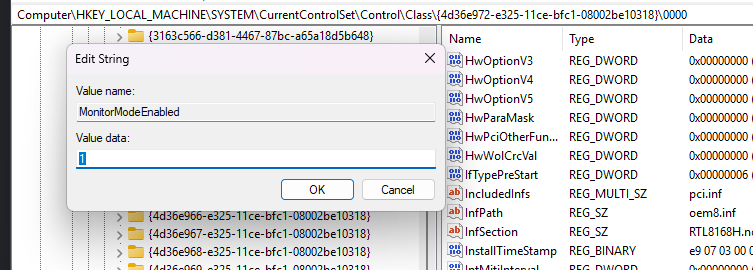

**Root cause.** The registry changes didn't resolve it. Consumer NIC drivers on Windows commonly remove the 802.1Q VLAN tag from frames they receive, and VirtualBox's bridged adapter only sees traffic after that driver has handled it. Traffic for VLAN 20 arrives from the switch tagged, so by the time it reached Proxmox, the tag was gone. Rocky's port on the VLAN-aware bridge was a member of VLAN 20 only, and the bridge places untagged frames in its default VLAN (VLAN 1). Just like a physical switch won't forward a VLAN 1 frame out a VLAN 20 access port, the bridge never delivered those frames to Rocky.

**Fix (design pivot).** Instead of depending on tag handling through the Windows driver, I moved the lab's services into VLAN 10 and let the Cisco gear handle all VLAN tagging. The PC-facing switch port (Gi0/2) uses native VLAN 10, so the untagged frames from the PC land in management. Rocky was given a static management address (10.10.10.50) on the untagged bridge, and the services became reachable right away.

VLAN 20 is still configured, routed, and protected by an ACL on R1, ready for hosts once the hypervisor moves to bare metal.

### What I took away from it

- Nested virtualization adds layers that can each silently drop traffic. Working from the inside out (container, VM, hypervisor, host, switch) is what isolated it.
- The cleanest fix was redesigning around the constraint, not forcing a workaround deeper into the host OS.

---

## Security Hardening

### Router (R1)

| Before | After |
|--------|-------|
| Telnet and SSH allowed on VTY lines                                 | SSH v2 only |
| VTY access open                                                     | Restricted to the management subnet (ACL 23) |
| Cisco Virtual Office banners and USB boot config from factory setup | Removed, replaced with an authorized-access warning banner |
| HTTP and HTTPS management servers enabled                           | Disabled |
| Unused ports and leftover factory ACLs                              | Unused ports shut down, leftover ACLs removed |

CDP is disabled so the router doesn't advertise its model and software version to neighbors. The WAN interface uses PAT, so outside traffic can't start connections to internal hosts.

### Server segmentation ACL

```
ip access-list extended BLOCK_SERVER_TRAFFIC
 permit tcp 10.10.20.0 0.0.0.255 10.10.10.0 0.0.0.255 established
 permit udp 10.10.20.0 0.0.0.255 eq domain 10.10.10.0 0.0.0.255
 permit icmp 10.10.20.0 0.0.0.255 10.10.10.0 0.0.0.255 echo-reply
 permit icmp 10.10.20.0 0.0.0.255 10.10.10.0 0.0.0.255 unreachable
 deny   ip 10.10.20.0 0.0.0.255 10.10.10.0 0.0.0.255
 permit ip 10.10.20.0 0.0.0.255 any
```

Applied inbound on the VLAN 20 SVI. My first version only had the deny and permit lines, which broke management access. A router ACL checks every packet on its own and doesn't remember connections, so when management connected to a server, the server's replies were dropped by the deny line. The four lines at the top let those replies through: `established` matches TCP packets that belong to a connection that's already open, plus DNS answers and ping replies. The server zone still can't open new connections into management.

### Switch (SW1)

| Before | After |
|--------|-------|
| No enable password, no local users | Enable secret and local admin account |
| No management IP | Management SVI on VLAN 10 (10.10.10.2) with a default gateway |
| VTY lines with no credentials | SSH v2 only, local login, restricted to the management subnet (ACL 23) |
| Console with no login | Console requires local login |
| CDP enabled | CDP disabled |
| No banner | Authorized-access warning banner |

Also in place: all 24 access ports assigned to unused VLAN 999 and administratively shut down, trunks limited to VLANs 10 and 20, PortFast on the host-facing port, VLAN 1 shut down, and the HTTP/HTTPS management servers disabled.

The 2960 runs IOS 12.2, which doesn't support type 9 (scrypt) hashes, so its passwords use type 5, the strongest option available on this IOS version.

Full sanitized configs are in [`/configs`](./configs).

---

## Verification

| Test | Result |
|------|--------|
| Proxmox can reach its gateway (10.10.10.1) | Pass |
| Rocky routes through 10.10.10.1 and reaches it | Pass |
| Uptime Kuma and Pi-hole containers healthy | Pass |
| Uptime Kuma monitoring R1 and internet reachability | Pass, 100% uptime |

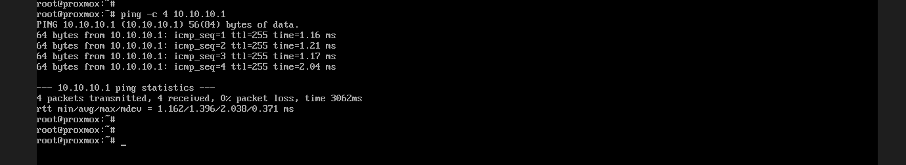

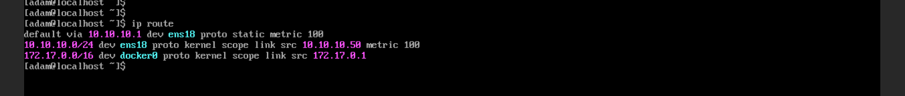

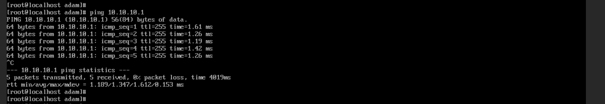

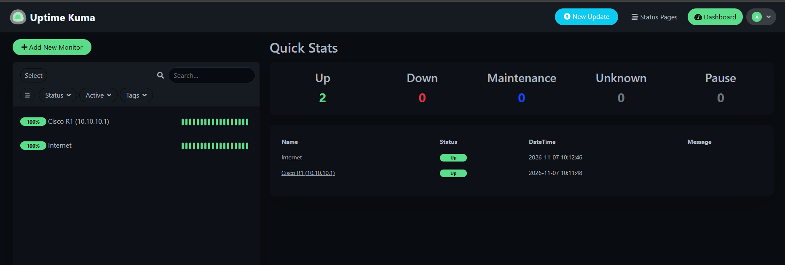

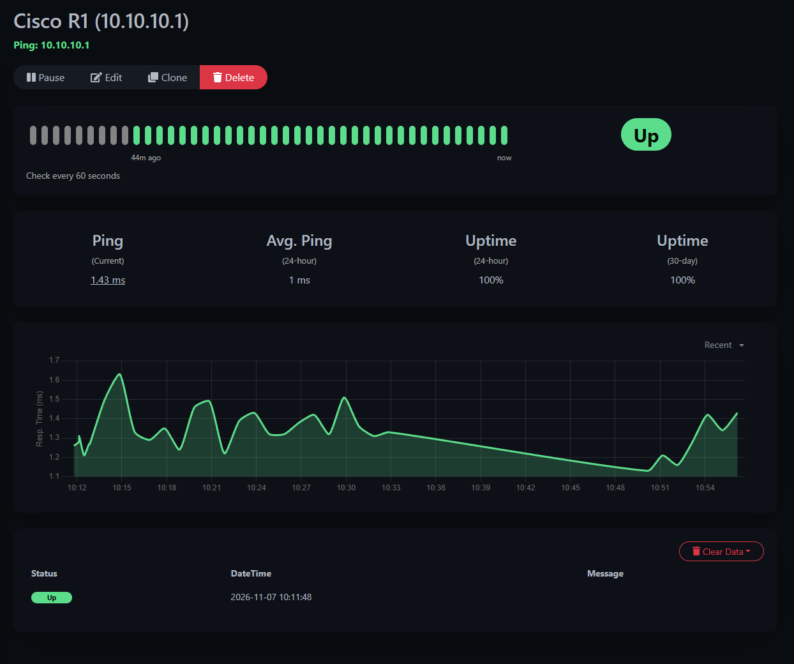

---

## Known Limitations

- **Nested virtualization on Windows.** Running Proxmox inside VirtualBox caused both problems above and limits performance.
- **Native VLAN is also the management VLAN.** Untagged traffic on a trunk lands in the native VLAN, which attackers can abuse to slip traffic into another VLAN (VLAN hopping). Best practice is an unused native VLAN. I use VLAN 10 on purpose because it's what lets the untagged traffic from my PC reach management (Problem 2), and I'd change it on dedicated hardware.
- **Container images.** Pi-hole runs on the `latest` tag. Pinning versions would make the setup reproducible.

## Next Steps

- Move Proxmox to dedicated hardware so VLAN trunks reach it natively, and complete the VLAN 20 server zone as designed
- Point the DHCP DNS setting at Pi-hole so clients actually use it for filtering
- Add alert notifications to Uptime Kuma
- Add SW1 (10.10.10.2) as a monitor in Uptime Kuma
- Automate config backups with Python (Netmiko) as part of my network automation studies

---

## Repo Structure

```
├── README.md
├── configs/
│   ├── R1-running-config.txt
│   └── SW1-running-config.txt
└── screenshots/
```
